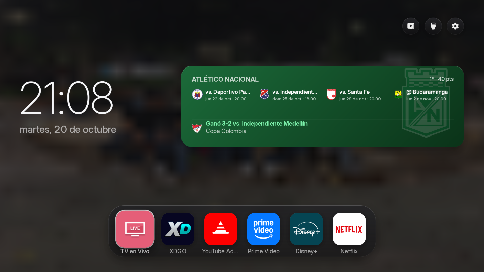

<div align="center">


# Free My TV — LG webOS

**A fast, ad-free home screen for LG TVs (webOS).**

Your apps as square icons on glass, trending picks, the weather at a glance, a look that follows the sunset —
and, on a rooted TV, no LG account, no 40-day limit, and Free My TV as the TV's actual Home.

[Install (Developer Mode)](#install-developer-mode) · [Install (rooted, root access)](#install-rooted-tv-homebrew-channel) · [Debloat](#debloat) · [Settings](#settings) · [How it works](#how-it-works) · [Credits](#credits)



</div>

## About this fork

This is a fork of [simbasjungles/free-my-tv](https://github.com/simbasjungles/free-my-tv) — the original project also
covers Google TV/Android TV and Samsung (Tizen); see its own README and [CLAUDE.md](CLAUDE.md) for that. This fork
keeps that code (so updates from upstream still merge cleanly) but this README only documents the **LG webOS** side
and what changed here:

- **Install as root, no LG account.** `webos/install.py --root` installs over a rooted TV's
  [Homebrew Channel](https://www.webosbrew.org/) SSH instead of LG's official Developer Mode — no 40-day renewal,
  no LG developer sign-in.
- **Free My TV as the actual Home.** `--home` makes it the Home key's app, the way it already is on Android TV: a
  small elevated service keeps it there and switches back to LG's home when the system asks for it by name, with
  the same kind of safety net as the Android `Watchdog` (a limit on redirects, so a broken build can't loop) — and
  three independent ways back, so it's never stuck.
- **The apps shelf and icons actually work without Developer Mode.** Installed as root, a plain web page can't call
  the TV's `listLaunchPoints` or read other apps' icon files — the bundled service does both, elevated, so the
  shelf and *All Apps* show real icons either way.
- **A cleaner look.** Each app is a square icon on glass, like its own badge, with its name below it — not a small
  logo centered on a flat brand-color card. No title or tabs at the top. No crypto prices — removed entirely,
  nowhere on the home screen, the drawer or Home Settings.
- **An Atlético Nacional widget**, where the title used to be: the next 4 matches, the last result and the league
  position — see [Settings](#settings).
- **Your own photos** as the background and the screensaver, rotating — see
  [Your own photos as the background and screensaver](#your-own-photos-as-the-background-and-screensaver).
- **"TV en Vivo" always leads the shelf**, besides its own button up top.
- **A debloat script for rooted TVs** — hides LG's bloat and ad/ACR overlays, stops background apps from
  preloading, and turns off promotions and Live Plus (ACR); reversible — see [Debloat](#debloat).

## Install (Developer Mode)

The original, official way: no root needed, nothing changed on the TV, Free My TV opens with a long press of a
number key. You need an LG TV (webOS 3 or newer) and a computer on the same Wi-Fi, with Python 3.

1. **On the TV**, open the LG Content Store and install **Developer Mode**. Sign in with a free
   [LG developer account](https://webostv.developer.lge.com), turn on **Dev Mode Status** (the TV restarts), then
   turn on **Key Server**. Write down the IP address and the passphrase it shows.
2. **On your computer**, get the code and build (`config.properties` is created on the first build — your city and
   your [TMDB key](#the-tmdb-key) go there):
   ```bash
   git clone https://github.com/checho1989/FreeMyTvLGWebOS && cd FreeMyTvLGWebOS
   python3 webos/build.py
   ```
3. **Install.** The first time, it asks for the TV's passphrase; updates don't:
   ```bash
   python3 webos/install.py 192.168.1.50
   ```
4. **On the TV**, while Free My TV is open, hold a number key on the remote. From then on, that key opens it from
   anywhere.

Developer Mode lasts about 40 days: open the Developer Mode app now and then and press **EXTEND**. To remove Free
My TV: `python3 webos/install.py 192.168.1.50 --uninstall`.

## Install (rooted TV, Homebrew Channel)

If the TV is already rooted ([RootMyTV](https://github.com/RootMyTV/RootMyTV.github.io), the webOS
[Homebrew Channel](https://www.webosbrew.org/)) there's no LG account and no 40-day limit.

1. **On the TV**, open Homebrew Channel and turn on **SSH** in its settings.
2. **On your computer**, get the code and build, same as above.
3. **Install.** The first time, it asks for the TV's root password (Homebrew Channel's default is `alpine`, until a
   key is installed):
   ```bash
   python3 webos/install.py 192.168.1.50 --root
   ```
4. **Optional: make it the Home key's app**, the way Free My TV already is on Android TV:
   ```bash
   python3 webos/install.py 192.168.1.50 --root --home
   ```
   Three independent ways back to LG's home, so it's never stuck on one:
   - `python3 webos/install.py 192.168.1.50 --root --switch-home` toggles it from the computer, right now.
   - A remote button, through [LG Input Mapper](https://github.com/anned20/lginputmapper) (install it from
     Homebrew Channel's app store): bind one to an `exec` action running
     `luna-send -n 1 luna://io.freemytv.service/switchHome '{}' </dev/null`. Home, D-pad, OK, Back, Settings,
     Power, volume and channel can't be remapped by that tool, so pick another button.
   - `--uninstall` (with `--home` or without) always restores LG's home first, over SSH, before removing the app —
     this works even if the Home key, the app and the remote button are all unusable.

   If Free My TV is ever removed some other way while it's still the Home app, the Home key opens nothing until the
   next reboot, when the boot hook notices, restores LG's home and removes itself.

To remove it: `python3 webos/install.py 192.168.1.50 --root --uninstall`.

## Debloat

On a rooted TV, [`webos/debloat/debloat.sh`](webos/debloat) (vendored unchanged from
[lucataco's gist](https://gist.github.com/lucataco/7c303b443934008a9031a55cfca552ec), MIT) hides LG's bloat, stops
background apps from preloading, and turns off a handful of promotional settings. Nothing is deleted and the root
filesystem isn't touched — only LG's own app block list, the preload policy and a few settings — so it's fully
reversible, a few apps are never hidden no matter what (below), and firmware updates install as they would on a
stock TV. The category table (what each one hides) and the full protected list are in
[`webos/debloat/README.md`](webos/debloat/README.md).

**Never hidden, whatever you ask for:** Home, Settings, Live TV, the HDMI inputs, the browser, first-run setup,
Homebrew Channel, and anything else whose absence is known to break the TV's own UI.

### 1. Preview — changes nothing

```bash
python3 webos/install.py 192.168.1.50 --root --debloat-plan
```

Prints every app the full run (every category) would hide, by ID and title, and how many. Nothing on the TV
changes; run it as many times as you like.

### 2. Apply

```bash
python3 webos/install.py 192.168.1.50 --root --debloat
```

Four things happen, in order:

1. **Hides the bloat tiles** — writes LG's own `blockedSystemAppList`. Tiles disappear from the launcher without a
   reboot on most firmware; the binaries stay on disk untouched.
2. **Stops preloading** LG Channels and the browser — the step that actually frees RAM, since hiding a tile alone
   doesn't stop the process. If either was already running, this closes it too.
3. **Turns off settings**: home-screen promotions, sports alerts, promo videos, the promotional streamer, content
   recommendations, and Live Plus (LG's automatic content recognition / ACR). Skips any that firmware doesn't
   have, and anything already off.
4. **Installs a boot hook** (`/var/lib/webosbrew/init.d/50-debloat`) that re-applies all of the above at every
   reboot — LG's own app manager can otherwise rewrite the block list after a component update.

### 3. Check what's changed

```bash
python3 webos/install.py 192.168.1.50 --root --debloat-status
```

Lists everything currently hidden (marked `ours` vs `LG/other`, so you can tell the two apart), whether the boot
hook is installed, and whether preloading/settings have anything to restore.

### 4. Undo, any time

```bash
python3 webos/install.py 192.168.1.50 --root --debloat-restore
```

Reverses all four steps, in reverse order: settings back to whatever they were before (not just "on" — the exact
original value), preloading back on, every tile it hid brought back (apps LG's own firmware already blocked stay
blocked), and the boot hook removed.

## Settings

The first values come from `config.properties`, created by the first build. Most of them can also be changed on
the TV, in *Free My TV* → *Home Settings*, and the TV's choice wins:

| Key | What it does | Default |
|---|---|---|
| `tmdb_key` | Your free TMDB key, for the picks | empty |
| `tmdb_region` | Your country (two letters): which titles are on which app | `US` |
| `latitude`, `longitude` | Your city, for the weather and the sunset | New York |
| `city` | The name on the weather card | `Weather` |
| `language` | `auto` (follows the TV), `en`, `es`, `pt`, `de` or `ru` | `auto` |
| `temperature` | `C`, `F` or `auto` | `auto` |
| `football_key` | Your free [Highlightly](https://highlightly.net/football-api/) key, for Atlético Nacional's next 4 matches | empty |

Changed something? Run `python3 webos/build.py` and install again.

### The TMDB key

Free, and it takes two minutes: create an account at [themoviedb.org](https://www.themoviedb.org/signup), then open
[Settings → API](https://www.themoviedb.org/settings/api) and request a developer key. Paste the *API Read Access
Token* (or the *API Key*) after `tmdb_key=`. It's your key: `config.properties` stays out of git.

### Your own photos as the background and screensaver

Drop images into a `family-photos/` folder at the repo's root (any `.jpg`, `.jpeg`, `.png` or `.webp`) and rebuild:
they replace the picks' photos as the background (rotating every 10 minutes) and the screensaver (rotating, no
title underneath). That folder is gitignored — the photos are bundled straight into the `.ipk` you install over
SSH, never into git or GitHub.

## How it works

- **Plain HTML, CSS and JavaScript** ([`web/`](web)), written for the Chromium of older webOS TVs, no frameworks.
  [`webos/build.py`](webos/build.py) packs it with `config.properties` into an `.ipk` without LG's own tools, the
  way `ares-package` does. To preview it on a computer: `python3 webos/build.py --preview`, then open
  `out/webos/index.html` (a stand-in lists sample apps).
- **[`webos/install.py`](webos/install.py)** installs it either through Developer Mode (`prisoner@TV:9922`, the TV's
  Key Server) or as root (`root@TV:22`, Homebrew Channel's SSH) — same `com.webos.appInstallService` the TV's own
  tools use.
- **[`webos/service/`](webos/service)** is a small Node service bundled in the same package, elevated through
  Homebrew Channel's `elevate-service`. It reads the installed apps and their icons (the page's own "public" Luna
  access can't), keeps Free My TV as the Home key's app when `--home` is used, and switches back to LG's home on
  request — the same technique as
  [guntiss/webos-galaxy-launcher](https://github.com/guntiss/webos-galaxy-launcher) (MIT).
- **On LG, [`web/tv.js`](web/tv.js)** talks to the TV over Luna (its service bus), the same calls LG's own launcher
  makes, trying the bundled service first and falling back to asking the page directly (which still works under
  real Developer Mode).
- **The Atlético Nacional widget** ([`web/data.js`](web/data.js)) mixes two free APIs: TheSportsDB (no key) for the
  crest, the last result and the league table, and Highlightly (your own key) for the next 4 matches — two calls
  (home and away; there's no single "either side" filter), throttled to once a day, or every 6 hours once the next
  match is within 2 days, so a key shared across several TVs stays well under its 100-requests-a-day limit.

## Privacy

No accounts, no analytics, no tracking. The app talks to TMDB, Open-Meteo (with the coordinates you set, or your
time zone's main city), TheSportsDB (a shared free key, no sign-up) and, only with your own `football_key` set,
Highlightly. Your settings stay on your computer and your TV; your own photos (`family-photos/`) stay out of git
entirely and go straight into the `.ipk` you install.

## Credits

- Built with [Claude Code](https://claude.com/claude-code), based on
  [simbasjungles/free-my-tv](https://github.com/simbasjungles/free-my-tv) (MIT).
- The Developer Mode install builds on what [@danielthejoker18](https://github.com/danielthejoker18) found in
  [FreeMyTvWebOS](https://github.com/danielthejoker18/FreeMyTvWebOS) (MIT): installing through Developer Mode and
  opening apps through the TV's service bus.
- Rooting: [RootMyTV](https://github.com/RootMyTV/RootMyTV.github.io) and the
  [webOS Homebrew Channel](https://github.com/webosbrew/webos-homebrew-channel). Remote-button remapping:
  [LG Input Mapper](https://github.com/anned20/lginputmapper).
- The Home-mode service (replacing LG's home, with a watchdog and a safe way back) follows the same technique as
  [guntiss/webos-galaxy-launcher](https://github.com/guntiss/webos-galaxy-launcher) (MIT).
- The debloat script is [lucataco](https://gist.github.com/lucataco/7c303b443934008a9031a55cfca552ec)'s, vendored
  unchanged (MIT).
- This product uses the TMDB API but is not endorsed or certified by [TMDB](https://www.themoviedb.org/).
- Weather data by [Open-Meteo.com](https://open-meteo.com/) (CC BY 4.0).
- Atlético Nacional's crest, last result and league position from [TheSportsDB](https://www.thesportsdb.com/); its
  next 4 matches from [Highlightly](https://highlightly.net/).
- Icons: [Material Symbols](https://fonts.google.com/icons) (Apache 2.0). Font: [Inter](https://rsms.me/inter/)
  (SIL OFL 1.1).
- Not affiliated with LG or any streaming service. App names and logos belong to their owners.

## License

[MIT](LICENSE). Fork it, change it, ship it.
